<!-- ================= BANNER ================= -->


<br/>

## 🎯 Sobre mí

<table>
<tr>
<td width="58%" valign="top">

```python
william = {
    "rol": "Backend Developer",
    "ubicacion": "Bogotá, Colombia 🇨🇴",

    "construyendo": [
        "Vetwilling (en producción)",
        "Backend de una app móvil",
    ],

    "formacion": [
        "Tecnólogo ADSO · SENA",
        "Contador Público · UNIMINUTO",
    ],

    "aprendiendo": ["React", "Laravel"],

    "tech": {
        "backend":  ["Python", "FastAPI", "PHP", "Laravel"],
        "frontend": ["JavaScript", "HTML", "CSS"],
        "movil":    ["Flutter"],
        "database": ["MySQL", "MariaDB"],
    },
}
```

> *"Talk is cheap. Show me the code."*
> <br/>— Linus Torvalds

</td>
<td width="42%" valign="top" align="center">
  
</td>
</tr>
</table>

<br/>

## 📬 Conecta conmigo

<div align="center">

<a href="https://www.linkedin.com/in/william-andres-sanchez-rojas-1a3096264/"></a>
<a href="https://williamsanchezr.github.io/Portafolio/"></a>
<a href="https://vetwilling.com"></a>
<a href="mailto:sanchezwill596@gmail.com"></a>
<a href="https://x.com/will6728"></a>
<a href="https://www.instagram.com/sanchezwill596/"></a>

</div>

<br/>

## 🛠️ Tech Stack

<div align="center">

<br/>


<br/><br/>


</div>

<br/>

## 📊 GitHub Analytics

<!-- Estas tarjetas las genera .github/workflows/profile-cards.yml todos los días -->
<div align="center">


</div>
